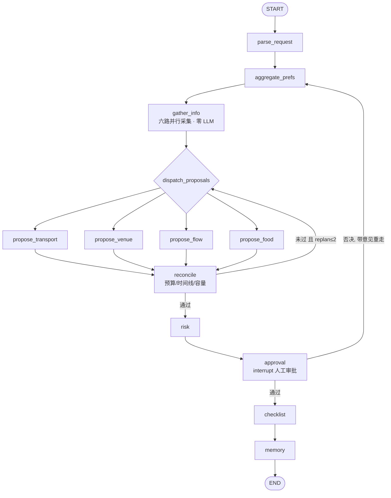

# 团建活动策划 Agent

基于 **FastAPI + LangGraph** 的多人团建活动策划 Agent。输入一句需求，自动跑完：

> 需求解析 → 偏好聚合 → 场地/天气/路线采集 → **四路并行报价** → 预算时间线约束消解 → 风险评估 → **人工审批** → 任务清单 + 团队记忆

全程状态持久化，服务重启后可从审批闸门恢复。

## 核心能力

- **需求解析** — 结构化输入零 LLM 直接组装；仅自由文本走一次 LLM 抽取，缺字段程序化返回 `missing_fields`
- **偏好聚合** — 纯 Python 统计 + 规则生成提示，全程零 LLM，同一输入逐字同输出
- **四路并行提案** — LangGraph `Send` 并行派发 交通/场地/流程/餐饮 四路 LLM 报价
- **约束消解** — 预算/时间线/容量三检纯程序；未通过带具体数字回炉（≤2 次），超限交人工裁决
- **风险评估** — 规则层纯 Python；命中标记才调一次 LLM 生成带报价的备选方案
- **人工审批（HITL）** — `interrupt()` 挂起于审批闸门，支持跨进程恢复
- **任务清单** — 一次 LLM 拆出分工表 / 采购清单（带预算）/ 可直接发群的通知文案
- **团队记忆** — 按 `team_id` 隔离沉淀团队画像，下次策划自动注入「上次你们……」上下文

## 架构



- 状态持久化：`AsyncSqliteSaver` → `backend/data/checkpoints.db`
- 团队记忆：`AsyncSqliteStore` → `backend/data/memory.db`
- 结构化输出统一走 `bind_tools + tool_choice='required'` 封装（DeepSeek 已调通）

## 快速开始

**后端**

```bash
cd backend
pip install -r requirements.txt
cp .env.example .env      # 填入自己的 Key
# 至少需配置: LLM_API_KEY / LLM_BASE_URL / LLM_MODEL_ID / AMAP_API_KEY
uvicorn app.api.main:app --port 8000
# Swagger: http://localhost:8000/docs
```

> 博查搜索 / 聚合火车票 / Unsplash 未配置时会优雅降级，不阻塞主流程，详见 `backend/.env.example` 注释。

**前端**

```bash
cd frontend
npm install
cp .env.example .env      # 可选，默认留空走 vite 代理指向 localhost:8000
npm run dev               # http://localhost:5173
```

**测试**

```bash
cd backend
python -m unittest discover -s tests -v   # 单元测试，全部离线不触网
python -m evals.run_evals                 # 评测，会真实调用外部接口
```

## API

启动后见 `http://localhost:8000/docs`。核心端点：

| 方法 | 路径 | 说明 |
|---|---|---|
| POST | `/api/event/parse` | 需求解析（唯一会调 LLM 抽取的端点）：`raw_text` → EventRequest；缺字段返回 400 + `missing_fields` |
| POST | `/api/event/plan` | 发起策划流程，跑到审批闸门挂起；返回 `thread_id` + `approval_payload` |
| POST | `/api/event/resume` | 提交审批结果 `{thread_id, approved, feedback?}`；通过 → 最终方案 + checklist，否决 → 带意见重走 |
| GET | `/api/event/health` | 健康检查（节点清单 / 持久化路径 / 库写权限探活） |
| GET/POST | `/api/map/*`、`/api/poi/*` | 通用地图工具（POI / 天气 / 路线 / 图片） |

**典型时序**：`/plan` → 拿 `status=pending_approval` + `approval_payload` → 审批页渲染 → 用户通过/否决 → `/resume` → 通过后 `data` 含四路提案 + `checklist`。

## 目录结构

```
backend/
├── app/
│   ├── api/routes/         # event.py(策划) · map.py · poi.py
│   ├── graph/              # graph.py 建图 · nodes.py 节点 · state.py 状态
│   │                       # model.py LLM 封装 · amap_client.py 高德 · ttl_cache.py 进程级缓存
│   ├── models/schemas.py   # 全部 pydantic 模型
│   └── prompts/            # 提示词模板
├── evals/                  # 评测用例 + 运行器
├── tests/                  # 单元测试（全离线）
├── scripts/                # 全量功能验证
└── data/                   # checkpoints.db / memory.db（运行时生成）
frontend/                   # Vue3 + TS + Vite：表单 / 生成 / 审批 / 终稿
docs/DESIGN.md              # 设计细节（改动代码前建议先读）
```

## 设计要点

项目在几个容易出错的地方做了程序化防护，细节见 **[docs/DESIGN.md](docs/DESIGN.md)**：

- **地名可信性** — 地名归一、归属过滤、非场地类剔除，宁可报「候选不足」也不给错数据（实测「杭州团建」曾把 138km 外的千岛湖排到候选第一位）
- **失败分类** — 临时故障才重试（退避 + 次数 + 总时长预算）；能力未接入刻意降级；配置缺失直接失败，不让模型拿常识编假方案
- **四路失败隔离** — 一路挂只废这一路，不掀翻已经跑完的另外三路
- **输入层口径** — 必填缺失直接 422，不消耗 LLM 与外部额度

## 已知限制

- 天气预报仅未来 3-4 天（高德限制）：活动日超出范围时不做天气风险判定，只在 `risk_report.summary` 里说明
- 跨请求偏好暂存 `_pref_store` 是**进程级全局列表**，多会话会互相累加，仅适合单实例演示
- 餐饮路的 LLM 搜索循环（≤3 轮）在部分模型上会「只顾搜不做方案」，此时走程序化兜底并显式标注「需人工复核」
- 付款/通知等不可逆动作的第二个 `interrupt` 为占位 TODO，未实现

## 开源协议

[MIT](LICENSE)
